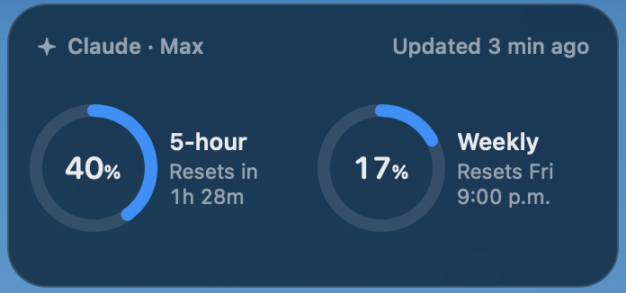

# Claude Meter

A small macOS desktop widget that shows how much of your Claude plan limits you've used: the **5-hour session limit** and the **weekly limit**, with the time until each one resets.

<p align="center"></p>

It sits on your desktop, above the wallpaper and below your app windows, and refreshes every 5 minutes.

## How it works

Claude Meter reads the OAuth token that **Claude Code** saves in your macOS Keychain (`Claude Code-credentials`). It only reads it and never writes, refreshes or sends it anywhere except Anthropic's API. It then polls the same usage endpoint Claude uses (`api.anthropic.com/api/oauth/usage`). The only thing it stores is the last reading.

> ⚠️ That endpoint is undocumented, so a future update on Anthropic's side could break the widget.

## Requirements

- macOS 14 (Sonoma) or newer, on Apple Silicon
- Xcode Command Line Tools (`xcode-select --install`)
- Claude Code installed and logged in with a Claude subscription (Pro/Max), so the token exists in the Keychain

## Install

```sh
git clone https://github.com/Andres201203/claude-meter.git
cd claude-meter
./build.sh --install
```

- `./build.sh` only builds `Claude Meter.app` in this folder. Open it with `open "Claude Meter.app"`.
- `./build.sh --install` builds it, starts it now and adds it as a login item so it starts every time you log in.
- `./build.sh --uninstall` removes the login item.

The first time it runs, macOS may ask for permission to read the Keychain item. Click **Always Allow**.

## Usage

- **Drag** to move it anywhere on the desktop
- **Double-click** to refresh
- **Right-click** to refresh, switch between medium and small size, or quit

## License

MIT
